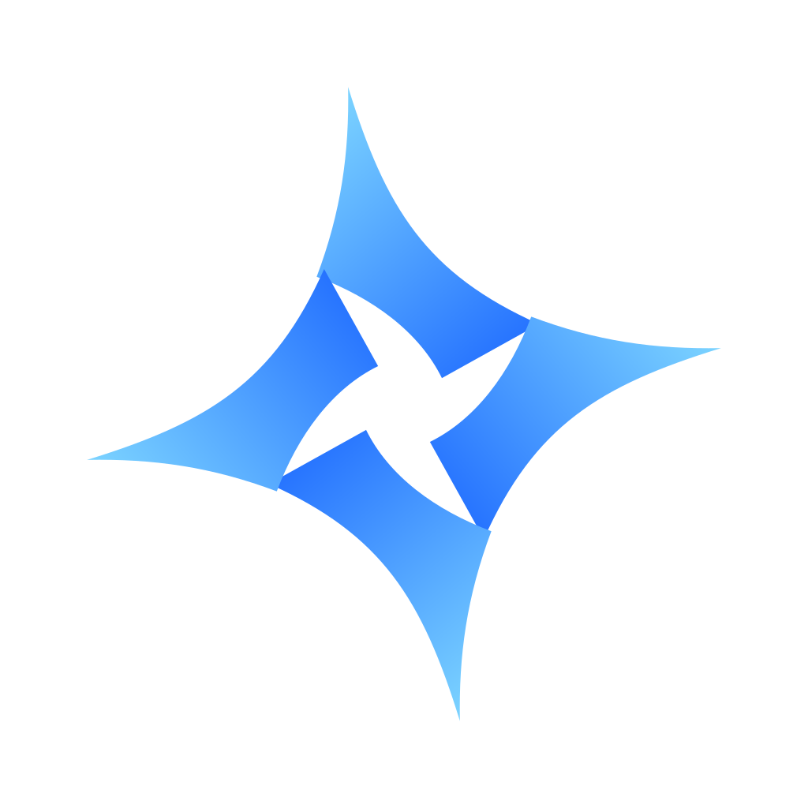

<p align="center"></p>
<h1 align="center">Nova Rust</h1>
<p align="center">Твой Minecraft. Твои сборки. Один лаунчер.</p>
<p align="center"><a href="https://github.com/Kovtyndumas/NovaLauncher/actions/workflows/rust-build.yml"></a>  </p>

**Nova** — десктопный Minecraft-лаунчер на Rust и Tauri. Чёрная тема, шрифт Unbounded, единый синий акцент и плавные анимации. Знакомый интерфейс Nova сохранён, а запуск игры, загрузки и работа с файлами перенесены на Rust.

## Скачать

### [Открыть релиз Nova Rust 3.0.0-beta.3 →](https://github.com/Kovtyndumas/NovaLauncher/releases/tag/rust-v3.0.0-beta.3)

В разделе **Assets** выбери свой установщик:

| Система | Файл | Как установить |
|---|---|---|
| Mac с Apple Silicon | `macOS-ARM64…arm64.dmg` | Открой образ и перенеси Nova Rust в Applications |
| Mac с Intel | `macOS-Intel…x64.dmg` | Открой образ и перенеси Nova Rust в Applications |
| Windows x64 | `Windows-x64…setup.exe` | Запусти установщик |
| Linux x64 | `Linux-x64….AppImage` или `.deb` | Разреши запуск AppImage или установи DEB |

Установщики публикуются после успешной сборки и проверок всех четырёх вариантов. Результаты и логи доступны в [GitHub Actions](https://github.com/Kovtyndumas/NovaLauncher/actions/workflows/rust-build.yml). Контрольные суммы — в `SHA256SUMS.txt` рядом с установщиками.

## Что умеет Nova

- **Minecraft с версии 1.0.** Каталог официальных релизов, общий кэш ресурсов и автоматический подбор Java.
- **Разные загрузчики.** Vanilla, Fabric, Quilt, Forge и NeoForge — у каждой сборки своя папка и настройки.
- **Modrinth внутри лаунчера.** Моды, шейдеры, ресурспаки и модпаки под выбранную версию игры и загрузчик.
- **Управление модами.** Поиск среди установленных файлов, включение и выключение, стабильные обновления, проверка зависимостей, удаление с восстановлением и откат.
- **Твои сборки и миры.** Импорт и экспорт `.mrpack`, копирование сборок, резервные копии миров и восстановление.
- **Серверы и история.** Избранные серверы, проверка доступности, подключение при запуске и история игровых сеансов.
- **Аккаунты.** Microsoft-вход для Minecraft Java Edition и офлайн-профиль по нику.
- **Персонаж.** Слежение за курсором, естественные жесты, вращение и настройки анимаций.
- **Три темы.** Чёрная, графитовая и светлая с одинаковым синим акцентом. Анимации реагируют на действия; фон остаётся спокойным.
- **Discord Rich Presence.** Сборка, версия Minecraft и время в игре.
- **Логи и вылеты.** Консоль, последний crash-report и подсказки по распространённым ошибкам.
- **26.3 RUST через Horizon.** Отдельный нативный движок; установка и подготовка доступны из Nova.

## Первый запуск

1. Открой Nova Rust и введи ник или войди через Microsoft.
2. Создай сборку: выбери Minecraft и загрузчик. Либо импортируй `.mrpack`.
3. Добавь контент через Modrinth и нажми **«Играть»**.

Java для работы самого лаунчера не нужна. Для Java-версии Minecraft Nova скачает нужную среду; также можно указать свою Java и объём RAM в настройках.

Шейдерам необходим совместимый Iris или OptiFine. Наличие версии в каталоге не означает, что все загрузчики и моды поддерживают её. Проверка метаданных помогает найти известные конфликты, но не заменяет проверку в игре.

## Перенос из старой Nova

В **Настройках → Данные → Импортировать** выбери папку старой Nova с `db.json`.

На macOS:

- Electron: `~/Library/Application Support/nova-launcher`
- Java: `~/Library/Application Support/nova-java`
- Rust: `~/Library/Application Support/nova-rust`

Импорт копирует сборки и миры. Исходные данные сохраняются. Microsoft-вход нужно выполнить заново. Удалённые в Rust-версии сборки остаются в `deleted-instances` внутри папки данных.

## Horizon · Minecraft 26.3 RUST

Это отдельный движок, а не загрузчик Java-модов. Nova использует официальный Horizon Launcher и закреплённую сборку `v0.2.97`. Перед игрой открой **«Войти в Horizon»** и авторизуйся аккаунтом Microsoft с Minecraft Java Edition. Fabric/Forge-моды и Java `.mrpack` в этот движок не устанавливаются.

Закреплённая сборка Horizon доступна для Mac ARM64, Windows x64 и Linux x64. Обычный Java Minecraft в Nova также доступен на Mac Intel.

## Разработка и автоматическая сборка

```sh
cargo test --release --locked
cargo run --release --locked
```

Подробные команды, системные зависимости, проверка интерфейса и выпуск установщиков: **[BUILD.md](BUILD.md)**.

Каждый push в `main` запускает сборки macOS ARM64, macOS Intel, Windows x64 и Linux x64. Тег `rust-v<версия>` публикует полный Rust-релиз после успеха всех платформ.

Архив исходной Electron-версии находится в [`legacy/electron`](legacy/electron). Текущий основной проект — Rust; старые Electron-установщики остаются в истории Releases.

## Если что-то не работает

Создай [Issue](https://github.com/Kovtyndumas/NovaLauncher/issues) и укажи ОС, версию Nova, Minecraft, загрузчик и шаги воспроизведения. Приложи последние строки консоли или crash-report без токенов и личных данных.

macOS-сборки имеют ad-hoc подпись целостности; Developer ID и нотарификация Apple пока не настроены. При первом открытии загруженного приложения macOS может потребовать разрешить его запуск в настройках конфиденциальности и безопасности. Старому Minecraft на Apple Silicon может понадобиться Rosetta.

Unbounded и сторонние компоненты сохраняют свои лицензии в [`ui/vendor`](ui/vendor).

**Created By Ktvx**
